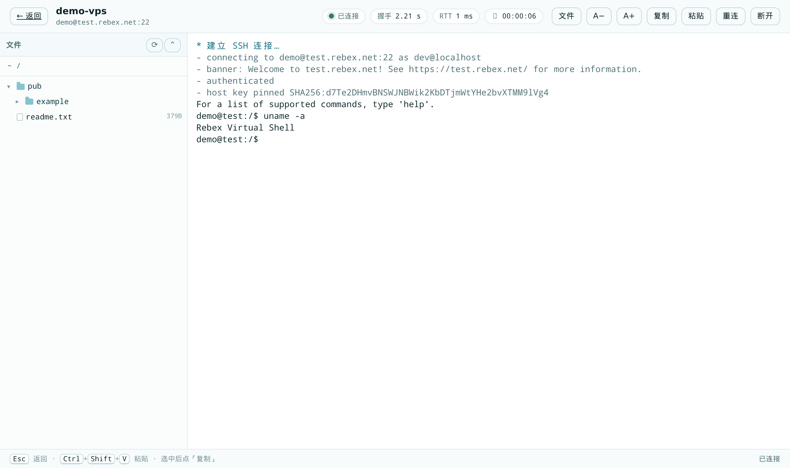
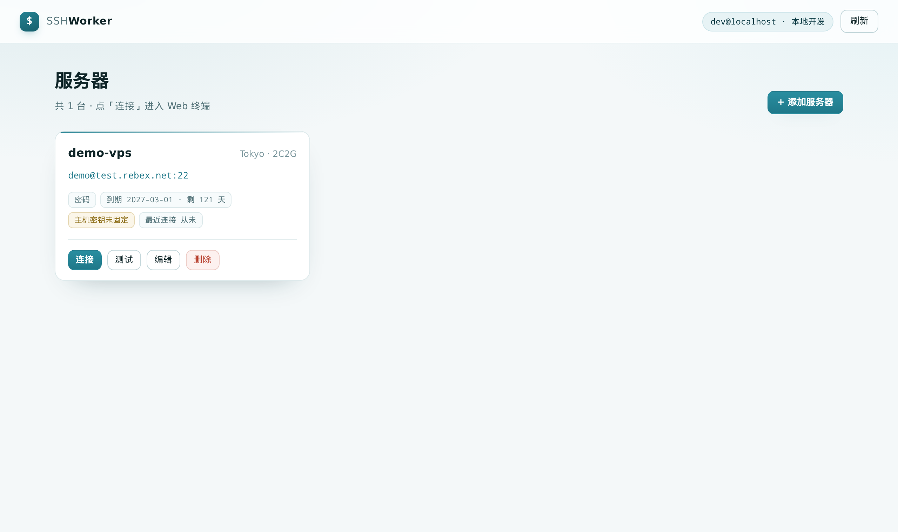
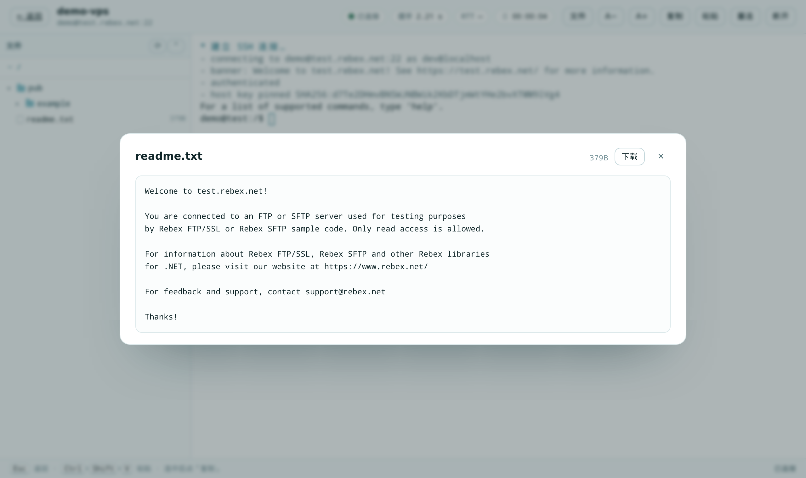

# SSH Worker

**A single-user SSH console that runs entirely on Cloudflare's edge.** Keep your VPS inventory in Workers KV, open a real terminal in the browser, browse files over SFTP, and let Cloudflare Access decide who is allowed in.

[English](README.md) · [简体中文](README.zh-CN.md)



<details>
<summary>More screenshots</summary>





</details>

---

## Why

Most web SSH panels need a server: a host that terminates the WebSocket, holds the SSH connection and stores credentials. This one doesn't. A Cloudflare Worker serves the UI, a Durable Object speaks SSH2 over a raw TCP socket opened with `cloudflare:sockets`, and Workers KV keeps the (encrypted) inventory.

- **No origin server, no jump host, no local client.** The browser talks to the edge; the edge talks to your VPS.
- **Zero Trust by default.** Cloudflare Access (Google, GitHub, OIDC, SAML, …) gates the hostname; the Worker then verifies the Access JWT itself against the team JWKS and an email allowlist.
- **Secrets stay encrypted.** Passwords and private keys are sealed with AES-256-GCM before they reach KV and are only decrypted inside the Durable Object that opens the connection.

## Features

| Area | What you get |
| --- | --- |
| Inventory | name, note, host, port, username, password or private key, optional expiry date (`yyyy-MM-dd`), last-used timestamp |
| Terminal | xterm.js over WebSocket, real PTY, resize sync, paste, copy selection, reconnect, font size (persisted), WebGL renderer with automatic DOM fallback |
| Session header | server identity, live status, SSH handshake time, browser↔edge RTT, session timer |
| File manager | SFTP tree with lazy expansion, refresh (keeps expansion), collapse all, copy path, **one-click `cd`** (pasted into the prompt, never executed) |
| File preview / download | text ≤ 512 KB and images ≤ 6 MB in a modal, streaming download up to 200 MB |
| Diagnostics | failed connections are re-probed at the TCP level: timeout vs. reset vs. no banner vs. HTTP port vs. Cloudflare-proxied hostname |
| Security | host key pinning (TOFU), CSRF origin check, 60-second session tickets, AES-256-GCM credentials, no secrets in API responses |
| UX | light theme, no build step, History API routing (`/`, `/s/:id/terminal`), deep links survive reload |

## How it works

```
browser ──HTTPS/WSS, Access cookie──► Cloudflare edge (Access) ──► Worker ──► Durable Object ──TCP──► VPS:22
                                         │                          │              │
                                    Access JWT                  static UI +    ssh2 client
                                    verification                /api/*         + SFTP + PTY
                                         │                          │              │
                                         └─────────────── Workers KV (encrypted credentials)
```

1. **Edge auth.** Cloudflare Access protects the hostname. Unauthenticated requests are redirected to the team login page; after login the browser carries a `CF_Authorization` cookie and every request gets a `Cf-Access-Jwt-Assertion` header.
2. **Worker.** Verifies that JWT locally (RS256 against the team JWKS, `aud`/`iss`/`exp`, optional email allowlist) and serves either static assets or `/api/*`.
3. **Durable Object.** One instance per terminal session (`idFromName(sid)`). It receives a 60-second HMAC ticket from the Worker, opens a TCP socket to the VPS, runs `ssh2` over it, and bridges the PTY to the browser over WebSocket. File requests (`/api/servers/:id/file`) go to the same instance, so SFTP reuses the live connection.
4. **KV.** `server:<id>` holds the encrypted record, `hostkey:<id>` the pinned host key fingerprint.

## Deploy

You need: Node.js 18+, the [`cf` CLI](https://github.com/cloudflare/cf) (or `wrangler`), a Cloudflare account with a zone, and a Zero Trust organisation.

```bash
git clone git@github.com:suchangv/ssh-worker.git
cd ssh-worker
npm ci                     # postinstall patches ssh2 for workerd (see below)
```

### 1. KV namespace

```bash
cf kv namespaces create --title ssh-worker-servers   # note the returned id
```

### 2. Configuration

The repository contains no personal identifiers — domain, KV id, Access team domain, AUD and allowlist are read from the environment:

```bash
cp .env.example .env.deploy    # fill in CF_DOMAIN, CF_KV_NAMESPACE_ID, …
```

`.env.deploy` is gitignored. `npm run deploy` and `npm run dev` source it automatically.

### 3. Access application

```bash
# self-hosted app for the hostname you are publishing on
cf zero-trust access applications create --body '{
  "name": "ssh-worker",
  "domain": "ssh.example.com",
  "type": "self_hosted",
  "session_duration": "24h",
  "policies": [{ "name": "only me", "decision": "allow",
                 "include": [{ "email": { "email": "you@example.com" } }] }]
}'

cf zero-trust access applications list      # → aud
```

Optional but recommended — sign in with Google instead of email one-time PIN:

```bash
cf zero-trust identity-providers create --body '{
  "name": "Google", "type": "google",
  "config": { "client_id": "…", "client_secret": "…" }
}'
```

The Google OAuth client needs exactly one redirect URI: `https://<team>.cloudflareaccess.com/cdn-cgi/access/callback`. Then point the application at it (`allowed_idps`) and decide whether to skip the Access login page (`auto_redirect_to_identity`).

### 4. Secret + deploy

```bash
printf 'APP_SECRET=%s\n' "$(openssl rand -base64 32)" > .env.production
npm run deploy -- --secrets-file .env.production
```

`APP_SECRET` is a base64-encoded 32-byte key used for credential sealing and session tickets. Store it somewhere safe — without it the stored credentials cannot be decrypted.

### 5. Login page (optional)

Zero Trust → Settings → Custom pages / organisation login design can set a logo, background and footer text:

```bash
cf zero-trust organization update --auth-domain <team>.cloudflareaccess.com \
  --login-design-background-color "#f4f8f9" \
  --login-design-text-color "#0f2528" \
  --login-design-logo-path "https://ssh.example.com/logo.svg" \
  --login-design-footer-text "Authorized accounts only"
```

If the logo lives on the protected hostname, add a path-scoped Access application with a `bypass` policy for that file only (see `public/logo.svg`).

## Local development

```bash
cp .dev.vars.example .dev.vars    # APP_SECRET (different from production!) + DEV_AUTH_BYPASS=true
npm run dev                       # cf dev → http://localhost:8787
```

`DEV_AUTH_BYPASS=true` is honoured **only when the request did not traverse Cloudflare's edge** (no `cf-ray` header) — production traffic can never take that branch. `wrangler dev` works too; it reads `wrangler.jsonc`, which keeps placeholders for anything servername-specific.

The local runtime refuses to connect to loopback addresses, so test the SSH path against a publicly reachable host.

## Security model

- **Two layers of auth.** The Access application gates the hostname; the Worker re-verifies the JWT (signature, `aud`, `iss`, `exp`, email allowlist) and fails closed if Access is ever detached.
- **Tickets.** WebSocket upgrades and file downloads carry a 60-second HMAC ticket bound to server id + session id; Durable Objects trust only that ticket, never the raw cookie.
- **CSRF.** Non-GET API calls require a same-origin `Origin` **and** an `x-csrf: 1` header, which a cross-site page cannot set without a preflight.
- **Credentials.** AES-256-GCM with a random IV, versioned envelope (`v1.`), decrypted only inside the session DO; the listing API never returns them.
- **Host keys.** Trust on first use: the `SHA256:` fingerprint is pinned on the first successful connection, and any change refuses to connect.
- **Service tokens.** Access service tokens work too (recorded as `service:<client_id>`) — useful for scripts. Their Access policy must use `decision: non_identity`.

## Connection diagnostics

When a connection fails, the Worker re-probes the endpoint independently of `ssh2` and reports what actually happened:

| Probe result | Meaning | Next step |
| --- | --- | --- |
| TCP connect times out | SYN dropped | firewall / security group, or `sshd` listening on loopback only |
| Connection refused | RST | wrong port, `sshd` down, or firewall `reject` |
| TCP up, no banner in 6 s | open port, nothing listening for SSH | wrong port, or a non-SSH service |
| Port answers HTTP | web server on that port | use the real SSH port |
| Banner received, handshake fails | network fine, protocol/auth problem | check `Ciphers`/`KexAlgorithms`, or credentials |
| Hostname resolves to Cloudflare IPs | orange-cloud proxy cannot carry SSH | switch DNS to “DNS only”, or use the origin IP |

Common real-world causes: a security group that only allows your home IP (Cloudflare's egress ranges change), `sshd` bound to `127.0.0.1`, or a Cloudflare-proxied hostname.

## Known limitations

- **Public targets only.** Workers' `connect()` cannot reach private ranges, so a VPS behind a private network is out of scope.
- **Patched ssh2.** workerd cannot instantiate ssh2's poly1305 WASM at import time and its `node:crypto` shim lacks `diffieHellman`, so `scripts/patch-ssh2.mjs` patches the package on install. Result: `aes*-ctr` + `hmac-sha2-*-etm` and `ecdh-sha2-nistp256` only — every modern OpenSSH server supports these, but `chacha20-poly1305` and `curve25519-sha256` are unavailable.
- **One connection per session.** Each terminal gets its own Durable Object; closing the tab ends the session (no session replay).
- **Preview/download limits.** 512 KB text, 6 MB images, 200 MB downloads.
- **UI language.** The interface is Chinese; the code and these docs are English.
- **No rate limiting.** Single-user tool behind Access; add a rate limit rule if you open it up.

## Repository layout

```
src/
  index.ts            HTTP router (/api/*), Access-guarded
  auth.ts             Access JWT verification (RS256 + team JWKS)
  store.ts            server inventory in KV, validation, encryption
  lib/encoding.ts     base64url / utf8 helpers
  lib/secretbox.ts    AES-256-GCM envelope
  lib/ticket.ts       short-lived HMAC session tickets
  ssh/session.ts      Durable Object: SSH + SFTP + PTY bridging
  ssh/tcp.ts          cloudflare:sockets → Node Duplex
  ssh/diagnostics.ts  TCP-level failure analysis
  ssh/sniff.ts        text/binary detection for previews
public/               static UI (no build step), xterm.js from CDN
scripts/              ssh2 patch, asset cache-busting, deploy helpers
access/login-page.html  reference for an Access custom login page
docs/                 screenshots
```

## Troubleshooting

- `APP_SECRET is not configured` — the secret was not uploaded; deploy with `--secrets-file`.
- `invalid Access token` / 401 on every API call — `CF_ACCESS_TEAM_DOMAIN` or `CF_ACCESS_AUD` is wrong; both must match the Access application.
- `Access token has no subject` — the request carried a service token without `common_name`, or Access is detached from the hostname.
- Terminal shows empty boxes — the font stack resolved to something without CJK glyphs; the terminal falls back to `monospace` automatically, and the font size can be changed in the session header.
- `Host key changed` — the server was reinstalled or replaced; delete the entry and add it again.

## License

MIT — see [LICENSE](LICENSE).
