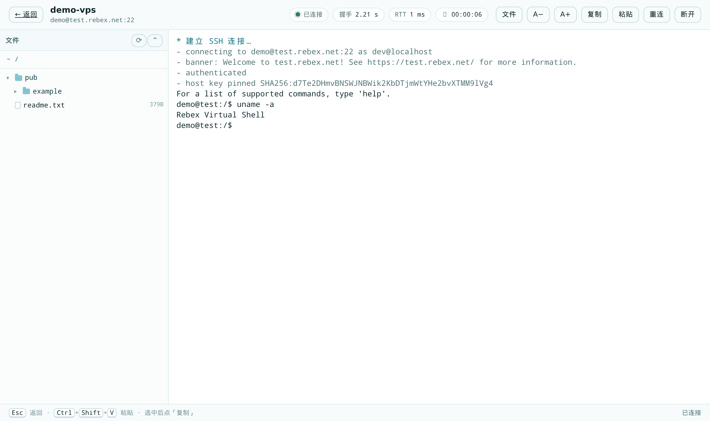
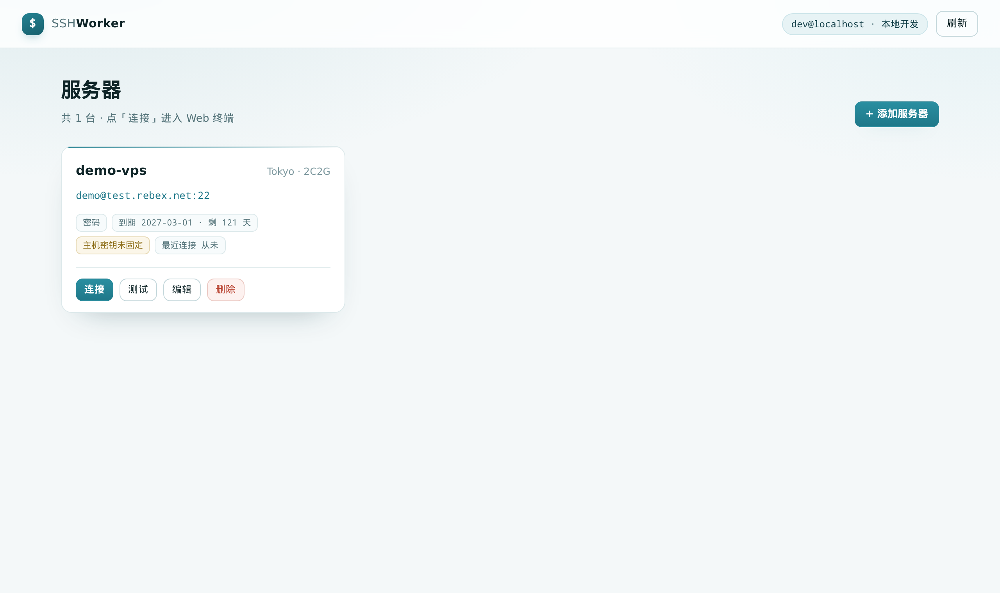
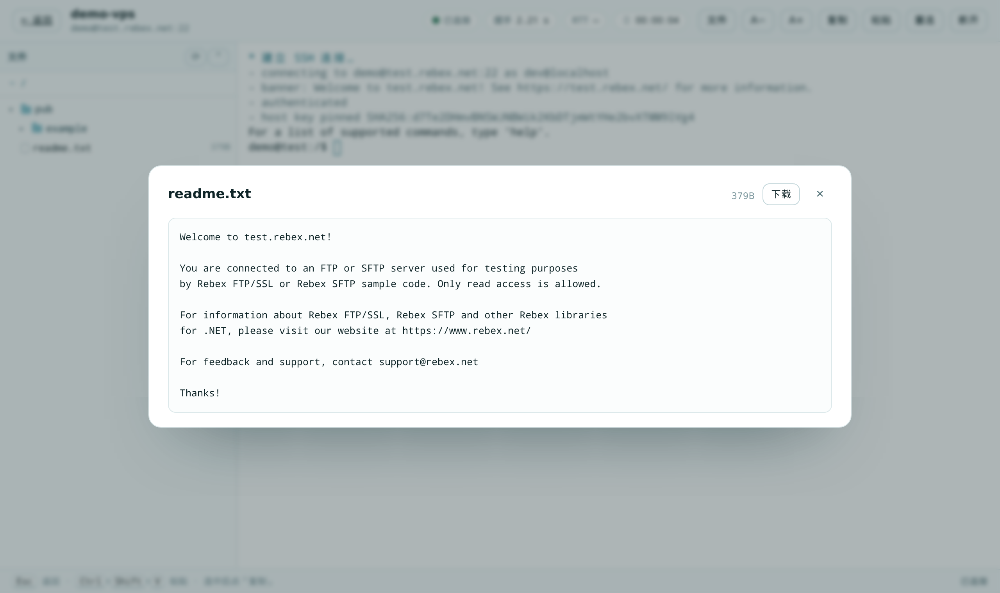

# SSH Worker

**一个完全跑在 Cloudflare 边缘上的单人 SSH 控制台。** 服务器清单存在 Workers KV，浏览器里开真终端，文件走 SFTP，谁能进来由 Cloudflare Access 决定。

[English](README.md) · [简体中文](README.zh-CN.md)



<details>
<summary>更多截图</summary>





</details>

---

## 为什么

大多数 Web SSH 面板都需要一台服务器：由它终结 WebSocket、维持 SSH 连接、保管凭据。这套不需要。Worker 提供界面，Durable Object 用 `cloudflare:sockets` 打开裸 TCP 并跑 `ssh2`，Workers KV 存（加密后的）清单。

- **没有源站、没有跳板机、不用装客户端。** 浏览器连边缘，边缘连你的 VPS。
- **默认 Zero Trust。** Cloudflare Access（Google / GitHub / OIDC / SAML …）守着域名，Worker 再自己对 Access JWT 验签（团队 JWKS + 邮箱白名单）。
- **凭据加密落库。** 密码和私钥用 AES-256-GCM 封装后才写入 KV，只在打开连接的那个 Durable Object 里解密。

## 功能

| 模块 | 内容 |
| --- | --- |
| 服务器清单 | 名称、备注、主机、端口、用户名、密码或私钥、可选到期日（`yyyy-MM-dd`）、最近连接时间 |
| 终端 | xterm.js + 真实 PTY，窗口尺寸同步、粘贴、复制选中、重连、字号（本地记忆）、WebGL 渲染 + 自动回落 DOM |
| 会话顶栏 | 服务器标识、状态灯、SSH 握手耗时、浏览器↔边缘 RTT、会话时长 |
| 文件管理 | SFTP 懒加载目录树、刷新（保留展开状态）、全部收起、复制路径、**一键 `cd`**（只粘贴不回车） |
| 预览 / 下载 | 文本 ≤ 512 KB、图片 ≤ 6 MB 弹窗预览；流式下载上限 200 MB |
| 诊断 | 连接失败时独立做 TCP 探测：超时 / RST / 无 banner / HTTP 端口 / 橙云代理域名 |
| 安全 | 主机密钥固定（TOFU）、CSRF 同源校验、60 秒会话票据、AES-256-GCM、接口永不返回密文 |
| 体验 | 亮色主题、无构建步骤、History API 路由（`/`、`/s/:id/terminal`）、刷新与直链可用 |

## 原理

```
浏览器 ──HTTPS/WSS + Access cookie──► Cloudflare 边缘(Access) ──► Worker ──► Durable Object ──TCP──► VPS:22
                                          │                          │              │
                                     Access JWT 验签              静态资源 +       ssh2 客户端
                                                                   /api/*          + SFTP + PTY
                                          │                          │              │
                                          └──────────────── Workers KV（加密凭据）
```

1. **边缘鉴权**：域名的 Access 应用拦截未登录请求，跳到团队登录页；登录后浏览器带上 `CF_Authorization` cookie，每个请求还会附 `Cf-Access-Jwt-Assertion` 头。
2. **Worker**：本地验证这个 JWT（RS256 + 团队 JWKS、`aud`/`iss`/`exp`、可选邮箱白名单），然后提供静态资源或 `/api/*`。
3. **Durable Object**：每个会话一个实例（`idFromName(sid)`）。它收 Worker 签发的 60 秒 HMAC 票据，连 TCP、跑 `ssh2`、把 PTY 桥接到 WebSocket。文件请求会打到同一个实例，SFTP 复用现有连接。
4. **KV**：`server:<id>` 存加密记录，`hostkey:<id>` 存固定的主机密钥指纹。

## 部署

需要：Node.js 18+、[`cf` CLI](https://github.com/cloudflare/cf)（或 `wrangler`）、一个已接入的 Cloudflare 域名、一个 Zero Trust 组织。

```bash
git clone git@github.com:suchangv/ssh-worker.git
cd ssh-worker
npm ci                     # postinstall 会给 ssh2 打 workerd 兼容补丁
```

### 1. 建 KV

```bash
cf kv namespaces create --title ssh-worker-servers   # 记下返回的 id
```

### 2. 填配置

仓库里不含任何个人信息 —— 域名、KV id、Access 团队域、AUD、白名单都从环境变量读：

```bash
cp .env.example .env.deploy    # 填 CF_DOMAIN、CF_KV_NAMESPACE_ID、CF_ACCESS_* …
```

`.env.deploy` 已被 gitignore；`npm run deploy` 和 `npm run dev` 会自动加载它。

### 3. 建 Access 应用

```bash
cf zero-trust access applications create --body '{
  "name": "ssh-worker",
  "domain": "ssh.example.com",
  "type": "self_hosted",
  "session_duration": "24h",
  "policies": [{ "name": "only me", "decision": "allow",
                 "include": [{ "email": { "email": "you@example.com" } }] }]
}'

cf zero-trust access applications list      # 拿 aud
```

可选但推荐 —— 用 Google 登录替代邮箱一次性验证码：

```bash
cf zero-trust identity-providers create --body '{
  "name": "Google", "type": "google",
  "config": { "client_id": "…", "client_secret": "…" }
}'
```

Google OAuth 客户端只需要一个回调地址：`https://<团队域>/cdn-cgi/access/callback`。建好后把它设进应用的 `allowed_idps`，再用 `auto_redirect_to_identity` 决定是否跳过 Access 登录页直接跳 Google。

### 4. 上传密钥并发布

```bash
printf 'APP_SECRET=%s\n' "$(openssl rand -base64 32)" > .env.production
npm run deploy -- --secrets-file .env.production
```

`APP_SECRET` 是 base64 编码的 32 字节密钥，用于封装凭据和签发会话票据。务必留好 —— 丢了就解不开已存的密码。

### 5. 登录页美化（可选）

Zero Trust → Settings 的登录页设计支持 logo、背景色和页脚文案：

```bash
cf zero-trust organization update --auth-domain <团队域> \
  --login-design-background-color "#f4f8f9" \
  --login-design-text-color "#0f2528" \
  --login-design-logo-path "https://ssh.example.com/logo.svg" \
  --login-design-footer-text "仅限授权账号访问"
```

如果 logo 放在受保护的域名上，要给它单独建一个按路径的 Access 应用并设 `bypass` 策略（参考 `public/logo.svg`）。

## 本地开发

```bash
cp .dev.vars.example .dev.vars    # 填 APP_SECRET（必须和线上不同）+ DEV_AUTH_BYPASS=true
npm run dev                       # cf dev → http://localhost:8787
```

`DEV_AUTH_BYPASS=true` **只在请求没经过 Cloudflare 边缘时生效**（没有 `cf-ray` 头），线上流量永远走不到这个分支。`wrangler dev` 也能用，它读的是 `wrangler.jsonc`（里面都是占位符）。

本地运行时无法连接回环地址，测 SSH 请拿一台公网可达的机器。

## 安全模型

- **两层鉴权**：Access 应用守域名，Worker 再验一遍 JWT（签名、`aud`、`iss`、`exp`、邮箱白名单）；即使 Access 应用被误删也 fail-closed。
- **票据**：WebSocket 升级和文件下载都要带 60 秒 HMAC 票据，绑定 server id + session id；Durable Object 只认票据，不认 cookie。
- **CSRF**：非 GET 接口要求同源 `Origin` **且** 带 `x-csrf: 1` 头（跨站无法伪造，否则触发预检）。
- **凭据**：AES-256-GCM + 随机 IV、带版本前缀（`v1.`），只在会话 DO 内解密，列表接口永不返回。
- **主机密钥**：首次连接信任并固定 `SHA256:` 指纹，指纹变化直接拒绝。
- **服务令牌**：Access Service Token 也可用（记为 `service:<client_id>`），方便脚本调用；其策略必须是 `decision: non_identity`。

## 连不上时怎么排查

连接失败时 Worker 会绕开 `ssh2` 单独探测一次 TCP，并给出结论：

| 探测结果 | 含义 | 下一步 |
| --- | --- | --- |
| TCP 连接超时 | SYN 被丢弃 | 防火墙 / 安全组没放行，或 `sshd` 只监听回环 |
| 连接被拒绝（RST） | 端口没开 / sshd 没跑 / 防火墙 reject | 确认端口与进程 |
| TCP 通但 6 秒无 banner | 端口通但不发 SSH 问候语 | 端口不是 SSH，或中间有错的转发 |
| 端口返回 HTTP | 那边是网站/面板 | 换回 sshd 的真实端口 |
| 收到 banner 但握手失败 | 网络没问题，是算法或认证 | 看 `Ciphers`/`KexAlgorithms`、凭据 |
| 域名解析到 Cloudflare IP | 橙云代理不转发 SSH | DNS 改「仅 DNS」，或直接填源站 IP |

常见真实原因：安全组只放行了自家 IP（Cloudflare 出口网段会变）、`sshd` 绑在 `127.0.0.1`、域名开了橙云代理。

## 已知限制

- **只能连公网目标**：Workers 的 `connect()` 到不了私有网段，内网 VPS 不在范围内。
- **ssh2 需要打补丁**：workerd 不允许在 import 时实例化 ssh2 的 poly1305 WASM，`node:crypto` 的 shim 也没有 `diffieHellman`，所以 `scripts/patch-ssh2.mjs` 会在安装时改包。结果是只支持 `aes*-ctr` + `hmac-sha2-*-etm` 和 `ecdh-sha2-nistp256` —— 现代 OpenSSH 都支持，但 `chacha20-poly1305`、`curve25519-sha256` 用不了。
- **一个会话一个 DO**：关标签页即断开，不保留回放。
- **预览/下载上限**：文本 512 KB、图片 6 MB、下载 200 MB。
- **界面是中文**，代码与文档是英文。
- **没有限流**：单人工具，靠 Access 兜；对外开放请加 Rate limiting。

## 目录结构

```
src/
  index.ts            路由（/api/*），Access 守卫
  auth.ts             Access JWT 验签（RS256 + 团队 JWKS）
  store.ts            服务器清单（KV）、校验、加密
  lib/encoding.ts     base64url / utf8 工具
  lib/secretbox.ts    AES-256-GCM 封装
  lib/ticket.ts       短期 HMAC 会话票据
  ssh/session.ts      Durable Object：SSH + SFTP + PTY 桥接
  ssh/tcp.ts          cloudflare:sockets → Node Duplex
  ssh/diagnostics.ts  TCP 层故障分析
  ssh/sniff.ts        预览用的文本/二进制判定
public/               静态前端（无构建），xterm.js 走 CDN
scripts/              ssh2 补丁、资源指纹、部署脚本
access/login-page.html  Access 自定义登录页参考模板
docs/                 截图
```

## 常见问题

- `APP_SECRET is not configured` —— 密钥没上传，部署时加 `--secrets-file`。
- 所有接口 401 / `invalid Access token` —— `CF_ACCESS_TEAM_DOMAIN` 或 `CF_ACCESS_AUD` 不对，两者都要与 Access 应用一致。
- `Access token has no subject` —— 用的是服务令牌但没 `common_name`，或 Access 已经和域名解绑。
- 终端显示方块 —— 字体栈落到了没有中文字形的字体；终端会自动回落到 `monospace`，顶栏也能调字号。
- `Host key changed` —— 服务器重装或换了机器；删掉条目重新添加即可。

## 许可证

MIT，见 [LICENSE](LICENSE)。
